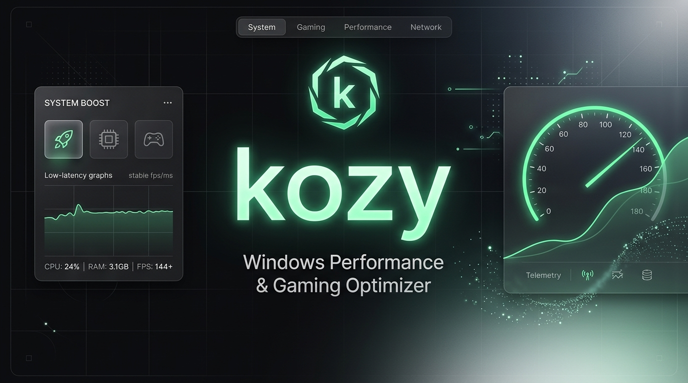
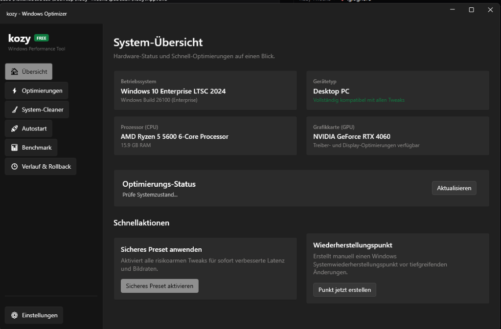

<div align="center">



# kozy — Modern Windows Performance & Latency Optimizer

**100% Free & Open-Source Windows Gaming, Frametime & Latency Tuning Suite**

[](LICENSE)
[](https://dotnet.microsoft.com/)
[](https://microsoft.com/windows)
[]()
[-0078D4.svg)](https://github.com/lepoco/wpfui)
[](https://github.com/mrKozy)

*A transparent, data-driven Windows tuning utility built with C# and .NET 9. Features automated system restore points, atomic state capture, journaling, and 1-click rollback.*

[Download](#download) • [Features](#key-features) • [Preview](#preview) • [Safety Guarantee](#safety-guarantee) • [Quick Start](#quick-start) • [Author](#credits--author)

---

</div>

## Preview

<div align="center">
  
</div>

---

## Why kozy?

Traditional gaming optimization scripts and black-box `.bat` / `.ps1` scripts often cause serious system stability issues: they overwrite registry keys destructively, lack safety checks, break Windows updates, and cannot be undone when problems arise.

**kozy** is engineered from the ground up to solve this:
- **Declarative JSON Manifests**: Every tweak is defined in typed JSON manifests validated against a strict schema.
- **State Capture**: System state is recorded before any change is applied.
- **1-Click Full Rollback**: Every session is logged in a local journal file. Revert any or all changes instantly at any time.
- **100% Free & Open-Source**: No paywalls, no licenses, no telemetry, and zero kernel drivers.

---

## Key Features

### Gaming & Low-Latency Tuning
- **MMCSS Prioritization**: High-priority thread scheduling for games and multimedia processes.
- **Hardware-Accelerated GPU Scheduling (HAGS)**: Reduces rendering latency by offloading scheduling directly to the GPU.
- **Disable GameDVR**: Eliminates background Game Bar capture overhead and micro-stuttering.
- **Raw Mouse Input (1:1)**: Disables Windows pointer acceleration via registry and `SystemParametersInfo` for true linear mouse movement.
- **Keyboard Repeat Delay**: Sets keyboard response delays to minimum for snappier movement in competitive titles.
- **Platform Clock Tuning**: Disables high-overhead synthetic timer ticks (`bcdedit /set useplatformclock false` and dynamic tick tuning).

### Power & CPU Performance
- **Ultimate Performance Power Plan**: Automatically duplicates and activates the unthrottled Windows Ultimate Performance plan.
- **CPU Core Parking Disabled**: Prevents CPU cores from dropping into high-latency sleep states during gameplay.
- **USB & PCIe ASPM Off**: Prevents USB selective suspend and PCIe Link State Power Management from throttling peripherals.

### Safe System Cleaner
- Safely identifies and clears temporary files (`%TEMP%`, `C:\Windows\Temp`), DirectX Shader Cache, NVIDIA Shader Cache, and leftover Windows Update download archives.
- Pre-calculates exact reclaimable disk space before touching any file.

### Non-Destructive Startup Manager
- View and manage all startup programs across Current User (`HKCU`) and Machine (`HKLM`).
- Toggles items gracefully via Windows `StartupApproved\Run` flags (`0x02` enabled, `0x03` disabled) rather than destructively deleting registry values.

### In-App Diagnostics & Benchmarks
- **Network Latency & Jitter**: Integrated multi-ping test calculating Min, Avg, Max RTT, Jitter, and Packet Loss.
- **Frametime Analysis**: Direct parser for Intel PresentMon CSV capture logs, extracting Average FPS, 1% Lows, 0.1% Lows, and Frametime Standard Deviation.

### Transparent History & Rollback
- Audit every past session with timestamps and exact changes applied.
- 1-click restore to reverse changes from any session.
- One-click launch to native Windows System Restore (`rstrui.exe`).

---

## Safety Guarantee

| Safety Feature | Description |
| :--- | :--- |
| **Windows Restore Point** | Automatically creates a native System Restore Point (`Checkpoint-Computer`) prior to applying tweaks. |
| **Strict Path Allowlists** | Modifies only explicitly approved system paths. Critical areas (`HKLM\SAM`, `SECURITY`, Defender, UAC) are permanently blocked. |
| **Anti-Cheat Safe** | Zero kernel drivers, no memory hooking, no game file modifications. 100% compatible with Vanguard, Easy Anti-Cheat, and BattlEye. |

---

## Download

Precompiled standalone binaries are available on the [Releases](https://github.com/mrKozy/kozy-tweaks/releases) page:

1. Download `Kozy.App.exe` and the `packs/` folder.
2. Run `Kozy.App.exe` as Administrator (required for registry, power, and service adjustments).
3. Choose a preset (**Safe**, **Balanced**, or **Max**) or select individual tweaks.

---

## Building from Source

### Prerequisites
- Windows 10 (21H2+) or Windows 11 (22H2, 23H2, 24H2) x64
- [.NET 9.0 SDK](https://dotnet.microsoft.com/download/dotnet/9.0)

### Clone & Build

```powershell
# Clone the repository
git clone https://github.com/mrKozy/kozy-tweaks.git
cd kozy-tweaks

# Build the solution
dotnet build

# Run unit tests (79 automated tests)
dotnet test

# Launch the desktop UI
dotnet run --project src/Kozy.App
```

### Publish Single-File Executable

```powershell
dotnet publish src/Kozy.App/Kozy.App.csproj -c Release -r win-x64 --self-contained true -p:PublishSingleFile=true -o publish/
```

---

## Credits & Author

Created and maintained by **[mrKozy](https://github.com/mrKozy)**.

- GitHub: [@mrKozy](https://github.com/mrKozy)
- Feedback & Contributions: Pull requests and feature suggestions are welcome.

---

## License

This project is licensed under the [MIT License](LICENSE) — free for personal and commercial use.
